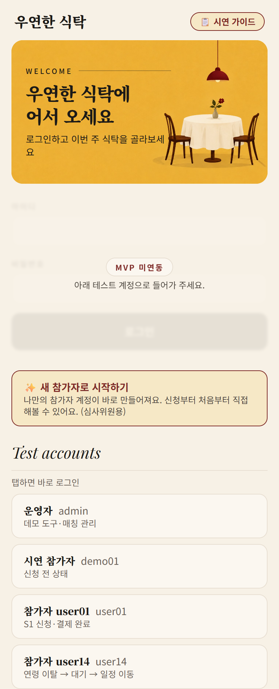
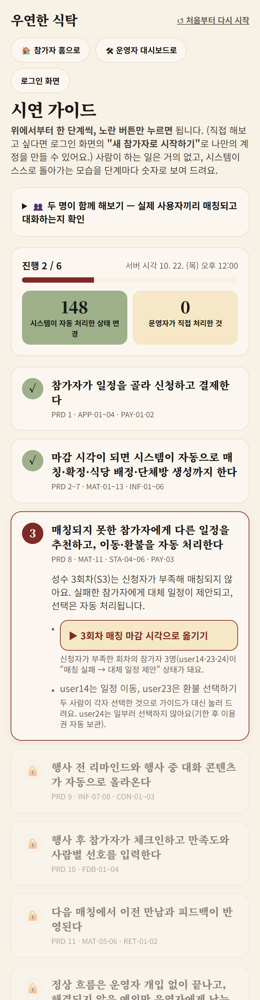
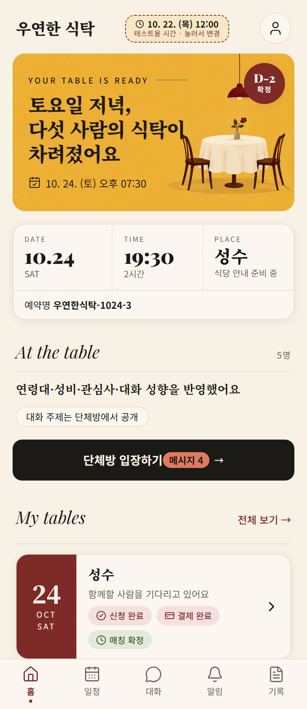
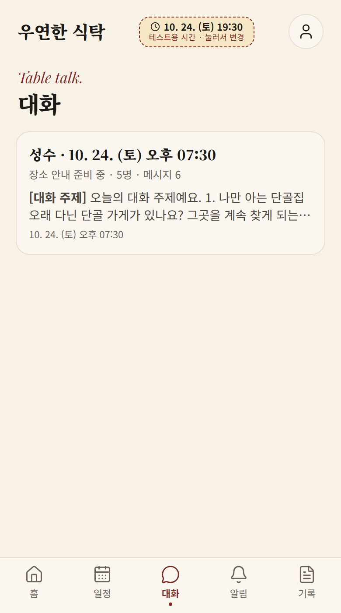
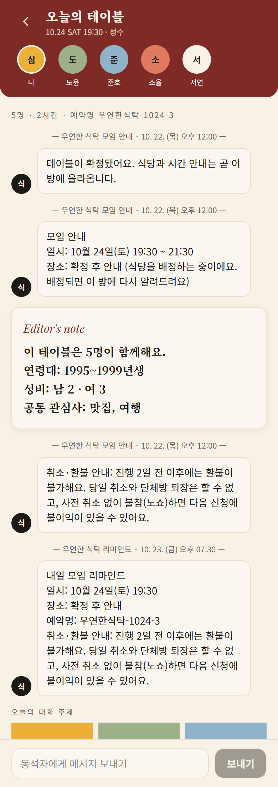
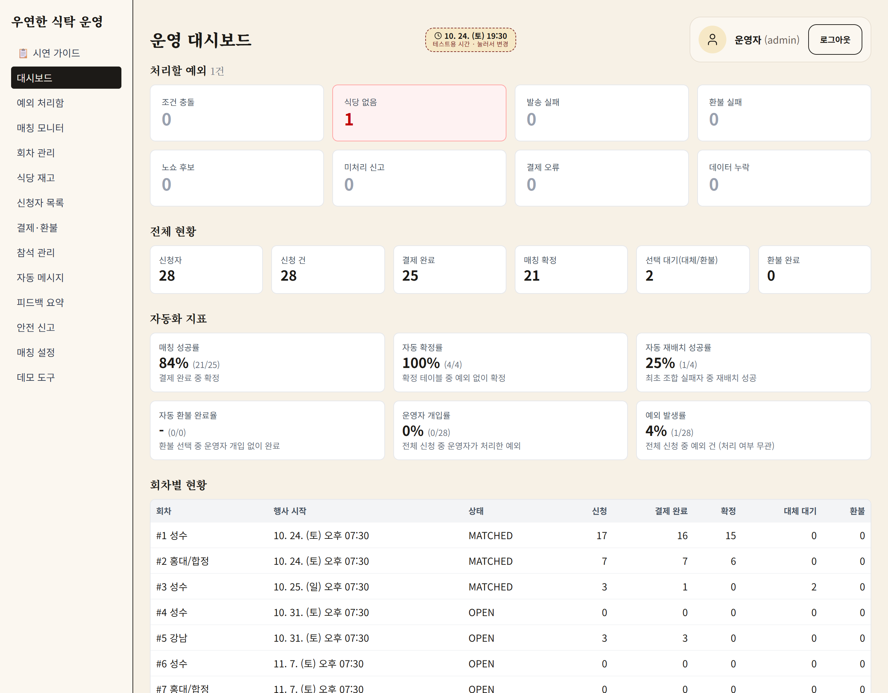
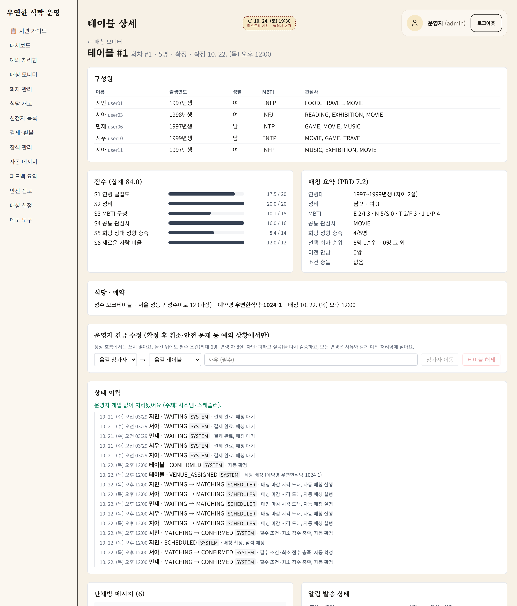
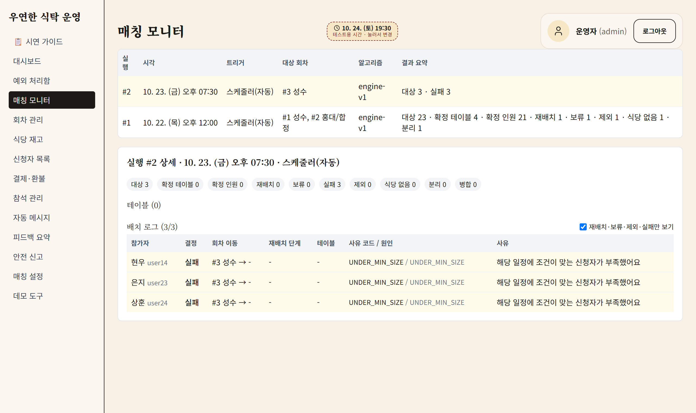
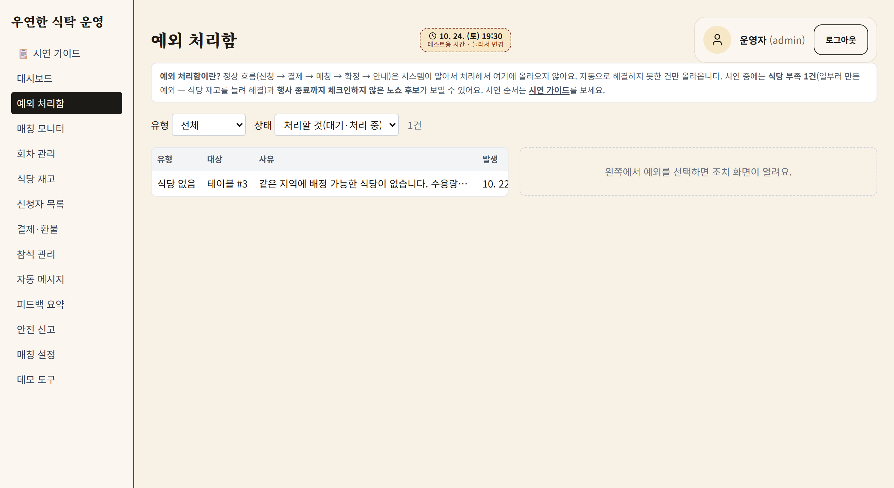
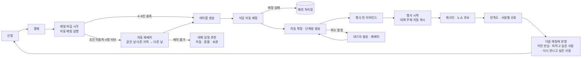

# 우연한 식탁 (siktak)

[](https://github.com/staytraveler/siktak/actions/workflows/ci.yml)

처음 보는 4~6명을 성향이 맞는 한 테이블로 연결하는 소셜다이닝 서비스 **'우연한 식탁'의 운영 자동화 MVP**입니다.
블레이버스 × 와썹하우스 「우연한 식탁 MVP 개발 해커톤」 출품작이며, 신청부터 다음 매칭까지를 앱 하나로 연결합니다.

> **정상 흐름은 자동, 운영자는 예외만.**
> 신청 → 결제 → 자동 매칭 → 자동 재배치 → 식당 배정 → 자동 확정·단체방 → 리마인드 → 체크인 → 피드백 → 다음 매칭까지
> 운영자 개입 없이 흐르고, 자동으로 풀리지 않은 건만 운영자 **예외 처리함**에 올라옵니다.

📄 심사·제출용 한 장 요약: **[docs/submission.md](docs/submission.md)**

---

## 1분 안에 써보기

| 대상 | 주소 |
|---|---|
| **시연 가이드 (여기서 시작하세요)** | https://siktak-rho.vercel.app/guide |
| 참가자 앱 (모바일 우선) | https://siktak-rho.vercel.app/app |
| 운영자 웹 | https://siktak-rho.vercel.app/admin |
| API 문서 (Swagger) | https://siktak.onrender.com/swagger-ui.html |

**가장 쉬운 방법은 시연 가이드입니다.** 위에서부터 한 단계씩, 노란 버튼만 누르면 PRD 18장 "해커톤 완료 조건" 12단계가 7단계로 이어집니다.
사람이 하는 일은 거의 없고, 단계마다 **"시스템이 자동으로 한 일"**(자동 처리 N건 · 운영자 개입 0건)이 숫자로 보입니다.
꼬이면 오른쪽 위 **"처음부터 다시 시작"** 한 번으로 시간과 데이터가 처음 상태로 돌아옵니다.

직접 해보고 싶다면 로그인 화면의 **"✨ 새 참가자로 시작하기"**를 누르세요. 나만의 참가자 계정이 바로 만들어집니다(외부 로그인 연동 없음).
창을 두 개(일반 창 + 시크릿 창) 열어 각자 새 참가자로 시작하면, **실제 사용자끼리 같은 테이블로 매칭되고 단체방에서 대화하는 것**까지 확인할 수 있습니다(가이드의 "두 명이 함께 해보기").

> **첫 접속 안내**: 백엔드는 Render 무료 인스턴스라 한동안 요청이 없으면 잠듭니다. 첫 요청은 최대 1분 걸릴 수 있으니 잠시 기다려 주세요.
> 서버 시간과 데이터는 **모든 사용자가 공유**합니다. 누가 시간을 옮기거나 초기화하면 다른 사용자에게도 적용됩니다.

### 시연용 계정 (공개)

| 구분 | ID | 비밀번호 | 용도 |
|---|---|---|---|
| 운영자 | `admin` | `siktak-admin!` | 운영자 웹, 데모 도구(`/admin/demo`) |
| 시연 참가자 | `demo01` | `siktak1234` | 프로필 입력 완료 · 신청 전 상태 |
| 시드 참가자 | `user01` ~ `user29` | `siktak1234` | 가상 참가자. 역할은 [docs/demo-scenario.md](docs/demo-scenario.md) |

모두 **시연 전용 가짜 계정**이며 실제 개인정보가 아닙니다. 결제는 모의(Mock), 앱 푸시도 모의이고, 외부 로그인·결제 연동은 하지 않았습니다.
사이트에는 가상 참가자 30명이 미리 들어 있어(코드에 고정된 시드), 혼자 테스트해도 4~6명 테이블이 만들어집니다.

---

## 화면 미리보기

시연 데이터로 매칭·확정까지 진행한 상태의 실제 화면입니다.

**참가자 앱 (모바일)**

| 로그인 | 시연 가이드 | 홈 (확정) | 대화 탭 | 단체방 |
|---|---|---|---|---|
|  |  |  |  |  |

**운영자 웹**

| 운영 대시보드 (자동화 지표) | 테이블 상세 (점수·요약·이력) |
|---|---|
|  |  |
| **매칭 모니터** | **예외 처리함** |
|  |  |

---

## 무엇을 만들었나

PRD(v0.2)의 **P0 전 항목**을 구현하고, P1 일부와 PRD 본문의 자동화 요구를 더했습니다.

| 영역 | 구현 |
|---|---|
| **자동 매칭·재배치·확정** | 마감 시각 스케줄러 → 4~6인 테이블 생성 → 조건 미충족·4명 미만 자동 재배치(4단계) → 운영자 승인 없이 자동 확정 |
| **필수 조건** | 4~6명 · 날짜·지역 일치 · 연령 차 8살 이내 · 차단·신고·피하고 싶음 없음 — **어떤 경우에도 완화하지 않음** |
| **선호 점수** | 연령 밀집도 · 성비 · MBTI · 공통 관심사 · 희망 성향 · 새로운 사람 비율 (운영자가 가중치·최소 점수 조정) |
| **피드백 → 다음 매칭** | "피하고 싶음"은 같은 테이블에서 분리, "다시 만나고 싶음"은 재회 가점, 이전 만남은 분산. 참여가 쌓일수록 반영 정보가 늘어남 |
| **실패 처리** | 대체 일정 추천 → 일정 이동(결제 유지) · 이용권 보관 · 자동 환불. 미응답은 이용권으로 자동 보관 |
| **취소** | 확정 전 취소(자동 환불·크레딧 복원) · 확정 후 취소 시 **대기자 자동 충원** → 테이블 유지 / 다른 테이블로 이동 / 대체 일정 |
| **안내 자동화** | 확정 알림 · 식당 정보 · 큐레이션 · 1일 전 리마인드 · 행사 시작 대화 주제 · 피드백 요청 · **미응답 1회 리마인드** · 다음 모집 시작 알림 |
| **결제·이용권** | 1회권 · 멤버십(1·3·6개월) · 보관 크레딧. 결제 실패는 예외 처리함으로, 재결제하면 자동 해소 |
| **운영자 웹** | 대시보드 · 예외 처리함 · 매칭 모니터 · 테이블 상세 · 회차 · 식당 재고 · 신청자(CSV) · 결제·환불 · 참석 관리 · 피드백·신고 · 자동 메시지 관리 · 매칭 설정 · **운영자 긴급 수정**(사유 필수, 필수 조건 재검증, 이력 기록) |
| **참가자 앱** | 프로필 · 일정 선택 · 신청·결제 · 상태(대기·재배치·확정·실패) · 단체방 · **대화 탭** · 알림(+브라우저 푸시) · 체크인·피드백 · 신고·차단 · 이력·다음 추천 |
| **개인정보** | 매칭 전 타 참가자 정보 비노출 · 선호·차단·신고 비공개 · [보관·삭제 정책](docs/privacy-policy.md) · 탈퇴 |

PRD ID별 구현 위치: [docs/submission.md](docs/submission.md)

## 자동화 흐름



설계 원칙 (절대 원칙으로 코드·테스트에 박아 두었습니다):

- **필수 조건은 완화하지 않는다.** 선호 조건만 점수로 합산한다. 명세: [docs/domain/matching.md](docs/domain/matching.md)
- **상태는 축마다 따로 저장하고, 변경은 도메인 서비스만 한다.** 신청·결제·매칭·참석 상태를 PRD 12장 값 그대로 쓰고, 모든 전이를 시각·주체·원인과 함께 기록한다. 명세: [docs/domain/states.md](docs/domain/states.md)
- **멱등성.** 매칭·테이블·단체방·결제·환불·알림은 두 번 실행돼도 결과가 같다.
- **예외는 로그로 끝내지 않는다.** 자동 처리 실패는 `ExceptionCase`로 저장해 운영자에게 보이고, 재시도 가능한 실패(알림·환불·결제)는 자동 재시도 후 반복 실패만 예외로 올린다.
- **시간은 `Clock` 빈으로만 읽는다.** 그래서 시연에서 시간을 앞당기면 실제 스케줄러와 같은 코드가 도래한 작업을 실행한다.
- **스케줄러는 DB를 폴링하지 않는다.** 메모리 일정만 보고, 재시작하면 지난 작업을 따라잡는다(catch-up).

---

## 이렇게 개발했습니다 — 사람 1명 + AI 세션 3개의 병렬 협업

해커톤은 7일입니다. 혼자서 순차로 만들면 매칭 엔진만으로도 시간이 다 가기 때문에, **역할을 나눈 AI 세션 셋을 병렬로 돌리고 사람은 판단에 집중하는 구조**로 진행했습니다.

| 역할 | 누구 | 하는 일 |
|---|---|---|
| **개발자 (김용현)** | 사람 | 방향·우선순위 결정, 계정·대시보드 작업(Neon·Render·Vercel), 세션 사이 신호 전달, 최종 판단 |
| **PM 세션** | Claude 앱 | 기획 · **작업지시서 작성** · 구현 결과 검토 · 전체 진행도 관리 (코드는 건드리지 않음) |
| **V1 세션** | Claude Code | 인증·프로필·신청·참석·피드백·신고 이력 · 운영 관리 화면 · 참가자 앱 화면 · 제출 문서 |
| **V2 세션** | Claude Code | 매칭 엔진(코어 → 순수 도메인 로직 → 운영 연결) · 알림·안내 자동화 · 매칭 실패 해결 · 대시보드·예외 처리함 · 통합 검증 |

**병렬이 깨지지 않게 만든 장치들**

- **파일 기반 핸드오프.** 세션끼리는 직접 대화할 수 없으므로 `docs/handoff/`의 메시지 파일(`pm-to-v.md` ↔ `v-to-pm.md`, `pm-to-v2.md` ↔ `v2-to-pm.md`)로 주고받습니다. 개발자는 내용을 옮기지 않고 **"PM 확인" 같은 신호만** 전달합니다.
- **작업지시서 21개** (`docs/tasks/`). 워크 하나 = 지시서 하나 = 대화 하나. 지시서 맨 아래 "완료 보고"를 채우고, 앞 작업의 **실제 결과를 보고 다음 지시서를 씁니다**(미리 다 써두면 구현과 어긋나기 때문). 지시서와 명세가 충돌하면 멈추고 사람에게 확인합니다.
- **git worktree로 같은 저장소를 병렬 작업.** 매칭 엔진은 별도 worktree·브랜치(`feat/matching-engine`)에서 만들고 main에 합쳤습니다. 파일 충돌 없이 두 세션이 동시에 전진합니다.
- **Flyway 마이그레이션 번호 분할.** V1 세션은 짝수, V2 세션은 홀수 번호만 씁니다. 번호 충돌과 "먼저 적용된 높은 번호 뒤에 낮은 번호" 문제를 규칙으로 막았습니다(`out-of-order` 허용 설정과 한 쌍).
- **공유 DB 충돌 회피 규칙.** 두 세션이 같은 개발 DB를 쓰므로, DB 통합 테스트는 "새로 만들거나 고친 클래스만" 돌립니다. 전체 DB 테스트는 PM이 지시한 시점에만 — 동시에 돌리면 서로의 데이터를 지워 테스트가 깨지기 때문입니다.
- **결정 로그 100건** ([docs/decisions.md](docs/decisions.md)). 기획 결정은 `[기획]`, 구현 중 내린 결정은 `[CC]`로 구분해 이유와 함께 남기고, 설계가 바뀌면 명세 문서도 함께 고칩니다.
- **권한 위임.** 지시서에 적힌 작업은 커밋·push까지 승인된 것으로 보게 하되, `main` 강제 push·적용된 마이그레이션 수정·필수 매칭 조건 완화는 **금지 목록**으로 박았습니다.
- **PRD가 최우선.** 충돌하거나 PRD에 없는 내용은 추측으로 채우지 않고 사용자에게 확인하고, 추측한 부분은 코드 주석과 문서에 `[해석]`으로 표시합니다.

**마지막 단계에서는 개발자가 PM 역할을 직접 맡아** PRD를 처음부터 다시 정독하며 P0 빈틈을 찾아 메웠고, 실제 서버로 종단 점검(아래)을 돌려 제출했습니다.
규칙 전문: [CLAUDE.md](CLAUDE.md) · 지시서 규칙: [docs/tasks/README.md](docs/tasks/README.md)

## 개발 과정 — 5일, 커밋 100개 이상, 아젠다 9개

작업은 블레이버스 워크스페이스의 **아젠다 → 워크** 구조(번호 = 작업지시서 번호)로 쪼개 진행했습니다. 지시서마다 담당 세션(V1/V2)이 있고, 끝나면 완료 보고와 `docs/progress.md`에 기록을 남겼습니다(진행 기록 23건).

| 아젠다 | 내용 | 담당 | 지시서 |
|---|---|---|---|
| **2. 기반** | 레포·프로젝트 세팅 · 배포 파이프라인(Vercel·Render·Neon·Actions) · **워킹 스켈레톤**(가짜 로직으로 신청→피드백까지 먼저 관통) · 데모 시계·시드 | PM+V1 | 2.1~2.4 |
| **3. 인증·신청** | 로그인·권한 · 프로필·회차 신청 정식화 (이용권·토스 결제는 **범위 제외 → 모의 결제로 확정**) | V1 | 3.1, 3.2 |
| **4. 매칭 엔진** | 순수 함수 코어 → 순수 도메인 로직 확장 → 운영 연결(스케줄러·재배치·식당 배정) | V2 | 4.1, 4.2, 4.4 |
| **5. 안내 자동화** | 알림·재시도·예외 전환 · 확정 공지·큐레이션·리마인드·대화 콘텐츠 | V2 | 5.2 |
| **6. 매칭 실패 해결** | 대체 일정 이동 · 이용권 보관 · 자동 환불 · 미응답 자동 보관 · 중복 환불 방지 | V2 | 6.1 |
| **7. 참석·피드백·안전** | 체크인·노쇼 후보·만족도·사람별 선호 · 신고·차단·이력·다음 일정 추천 | V1 | 7.1, 7.2 |
| **8. 운영자 웹** | 대시보드·예외 처리함·매칭 모니터(V2) · 회차·식당·설정·신청자·피드백 관리(V1) | V1+V2 | 8.1, 8.2 |
| **9. 참가자 앱** | 디자인 시스템 · 단체방 메시지 · UX 다듬기 | V1 | 9.1~9.3 |
| **10. 통합·제출** | 시연 문서 · 통합 검증·리허설 보완 · 제출 패키지 · 최종 점검 | V1+V2 | 10.1~10.4 |

**날짜별로 보면**

| 날짜 | 커밋 | 한 일 |
|---|---|---|
| 10/17 | 62 | 레포·배포 파이프라인, 워킹 스켈레톤으로 **하루 만에 end-to-end 관통**, 데모 시계·시드. 동시에 V2가 매칭 엔진 코어→순수 로직→운영 연결, V1이 로그인·권한, V2가 매칭 실패 해결까지 |
| 10/18 | 15 | 체크인·노쇼·피드백 · 알림·안내 자동화 · 신고·차단·추천 · 운영자 웹(대시보드·예외 처리함·매칭 모니터·관리 화면) |
| 10/19 | 6 | 참가자 앱 디자인 시스템 |
| 10/20 | 7 | 단체방 메시지 · 통합 검증·리허설(동시 환불 레이스 등 버그 수정) · 제출 문서 |
| 10/21 | 20 | PRD를 처음부터 다시 정독해 P0 빈틈 보강 — 이름·연락처, 멤버십, 푸시, 결제 오류·조건 충돌 예외, 취소·환불·재배치, 대기자 충원, 운영자 긴급 수정, 재회 희망 반영 · 순서형 시연 가이드 · 실제 서버 종단 점검 |

**방식에서 특히 효과를 본 것**

- **워킹 스켈레톤 먼저.** 매칭도 결제도 가짜로 두고 신청→피드백이 끝까지 도는 얇은 흐름을 먼저 만든 뒤(2.3), 노드 단위로 실제 구현으로 바꿨습니다. 어느 시점에 멈춰도 시연 가능한 상태가 유지됩니다.
- **범위를 일찍 자르기.** 외부 연동은 하루 이내, 한 연동에서 1시간 넘게 막히면 Mock으로 확정하고 보고하는 규칙을 두고, 토스 결제(3.4)는 실제로 그렇게 제외했습니다. 그 덕에 자동화 로직에 시간을 썼습니다.
- **P0 먼저, 끝까지.** PRD 18장 12단계 시나리오가 돌기 전에는 P1을 시작하지 않았고, 마지막에 PRD를 다시 정독해 빠진 P0를 전부 메웠습니다.
- 자세한 기록: [docs/tasks/](docs/tasks/README.md) · [docs/progress.md](docs/progress.md) · [docs/decisions.md](docs/decisions.md)

## 기획·의사결정 과정 — PM 세션의 판단 기록

코드만으로는 보이지 않는 "왜 그렇게 했나"를 PM 세션의 판단 기준으로 정리했습니다. 항목을 눌러 펼쳐 보세요.

<details>
<summary><b>1. 아젠다 구성과 순서</b> — 배포와 흐름 뼈대를 먼저, 화면은 나중에</summary>

- PRD 18장 완료 조건(12단계 시연 시나리오)이 끝까지 도는 것을 기준으로 삼았습니다. **"P0 먼저, 끝까지 · 화면 수보다 end-to-end 시연 가능 여부 우선"** 원칙을 `CLAUDE.md`에 고정했습니다.
- 순서: 초기 세팅·배포 파이프라인 → 전체 흐름 가짜 로직 연결 + 데모 시계·시드 → 로그인·신청 → 매칭 엔진 → 안내 자동화 → 실패 해결 → 참석·피드백·안전 → 운영자 어드민 → 참가자 화면 → 통합 검증·제출.
- **배포와 흐름 뼈대를 먼저 깔았습니다.** 마지막 날 "로컬에선 됐는데 배포에서 안 됨"을 피하고, 이후 작업은 가짜를 진짜로 바꾸기만 하면 되게 하려는 것이었습니다.
- 참가자 UI는 톤앤매너를 개발자가 직접 컨펌해야 해서 기능 완성 뒤로 미뤘습니다.

</details>

<details>
<summary><b>2. V1·V2 분담과 충돌 방지 규칙</b> — 도메인 단위로 나누고, 충돌은 규칙으로 막기</summary>

- 분담은 **도메인 단위**입니다. V1은 인증·프로필·신청·참석·안전·회차 관리, V2는 매칭 엔진·파이프라인·알림·실패 해결·운영 대시보드. V2는 별도 worktree(브랜치)에서 작업하고 끝날 때마다 main에 합쳤습니다.
- **마이그레이션 번호**는 V1 짝수, V2 홀수로 나눴습니다. 동시에 같은 번호를 만들어 Flyway가 깨지는 것을 막으려는 규칙입니다.
- **DB 테스트**: 두 세션이 개발 DB 하나를 같이 써서 동시에 돌리면 락과 데이터 정리가 서로를 막았습니다. 그래서 "새로 만든 테스트 클래스만" 돌리고, 전체 실행은 통합 검증 때 한 세션만 하게 했습니다.
- **배포 사이트 리허설 중에는 다른 세션의 push를 막았습니다.** 재배포로 서버가 재시작되면 리허설이 깨지기 때문입니다. 남의 영역을 건드리면 보고하게 하고, 충돌이 나면 기준이 될 쪽을 미리 정해 줬습니다.
- **커밋·push 권한은 V 세션에 위임**했습니다. 매번 승인을 기다리느라 흐름이 끊겼기 때문입니다.

</details>

<details>
<summary><b>3. 범위에서 뺀 것과 우선순위 변경</b> — 일찍 자르고, 구조는 막지 않기</summary>

- **실결제(토스 테스트 연동)**: 빼고 Mock 결제로 갔습니다. 결제는 교체 가능한 구조(포트·어댑터)로 만들어 설정값 하나로 전환되게 했고, "외부 연동은 하루 이내, 막히면 Mock으로 확정"이라는 규칙에 따른 결정입니다.
- **회원가입**: 신청 작업 때 한 번 범위에서 뺐고, 막판에 다시 넣으려 했지만 시간이 부족해 UI 개선을 우선하기로 하고 다시 취소했습니다.
- **소셜 로그인·식당 예약 연동**: 방식이 정해지지 않아 "구조는 막지 않되 이번엔 안 함"으로 정리했습니다.
- **우선순위를 바꾼 순간**: 배포본을 직접 써 본 뒤 "UX가 아직 안 좋다"는 판단이 나왔을 때입니다. 남은 시간을 참가자 화면 개선에 돌렸고, 그 시점부터 세션도 V1 하나로 합쳤습니다.

</details>

<details>
<summary><b>4. 막히거나 틀렸다가 고친 일</b> — 실수와 교훈</summary>

- **DB를 24시간 깨워두는 설계를 승인했다가 되돌렸습니다.** 무료 사용량을 다 쓰게 된다는 지적을 받고, DB 없이 응답하는 헬스체크 · 메모리 기반 스케줄러 · 커넥션 풀 0 · 재기동 시 밀린 작업 처리(catch-up)로 바꿨습니다. 교훈: **무료 인프라에서는 "꺼져도 되는 설계"가 기본값**입니다.
- **로컬 DB 테스트가 너무 느렸습니다.** 싱가포르 DB 왕복으로 테스트 하나에 몇 분씩 걸리고, 멈춘 프로세스가 남아 서로를 막았습니다. 그런데 이미 GitHub CI가 로컬 Postgres로 전체 테스트를 3분 안에 돌리고 있었습니다. 교훈: **검증 수단이 이미 있는지 먼저 확인하기**.
- **CI가 오래 빨간색이었는데 늦게 봤습니다.** 원인은 이중 환불이 아니라 동시 알림 저장 충돌과 테스트 정리 누락이었습니다. 교훈: **CI 결과를 매 작업의 완료 조건에 넣었어야** 했습니다.
- **문서 동기화 사고.** PM이 쓴 지시 파일이 V의 git 작업에 덮어써지거나, 반대로 PM 섹션이 V 커밋으로 되돌려졌습니다. 그 뒤로는 저장 후 디스크 내용을 다시 읽어 확인하고, `CLAUDE.md`에 "PM 섹션 되돌리지 않기"를 명시했습니다.
- **세션 비용과 속도.** 긴 컨텍스트 때문에 느리고 비쌌습니다. 그래서 작업 하나마다 `/clear`, 구현 세션은 Sonnet, 지시서는 "계획 확인 없이 바로"로 정했습니다.

</details>

<details>
<summary><b>5. 지시서를 앞 작업 결과를 보고 쓴 이유</b> — 문서로 남는 판단</summary>

- 미리 다 써두면 실제 구현(API 경로, 상태값, 남은 버그)과 어긋납니다. 그래서 완료 보고와 `progress.md`를 읽고 다음 지시서를 하나씩 썼습니다.
- 완료 보고의 "PM 확인 필요"를 다음 지시서 맨 위에서 답하는 구조라, 판단이 문서로 남고 다음 작업이 그 답을 전제로 시작됩니다.
- 예: 리허설에서 나온 추천 빈 목록·장소 미표시·확정 주체 미노출 → 바로 다음 보완 지시서(10.3). 디자인 적용 보고의 "메시지 전송 API 없음" → 단체방 지시서(9.2).

</details>

<details>
<summary><b>6. 개발자가 직접 내린 결정</b> — 사람이 판단한 것</summary>

- **PRD 우선 원칙**: PRD가 최우선이고, PRD와 충돌하거나 PRD에 없는 내용은 구현 전에 확인합니다.
- **기술 스택**: Java·Spring + React(TypeScript), Vercel·Render·Neon 배포. 12월~1월 실서비스 전환을 고려해 Mock만이 아니라 API 연결이 가능한 확장 구조를 요구했습니다.
- **비용 0원 원칙**: 상금이 없는 해커톤이라 Render 유료 플랜을 쓰지 않기로 했습니다. 그래서 Free 인스턴스 + 외부 핑 + 재기동 복구로 갔습니다.
- **진행 방식**: 개발자는 세션 간 신호 전달, 계정·키 작업, 중요 판단만 맡고, PM과 V는 파일로 소통합니다.
- **디자인**: 시안 세 개 중 감성 매거진 톤을 골랐고, 시안을 두 번 반려한 끝에 직접 레퍼런스 화면과 히어로 이미지를 주며 최종 톤을 정했습니다. 그림은 나중에 이미지로 바꿀 수 있게 하라고 요구했습니다.
- **마무리 판단**: 회원가입 대신 UI를 우선했고, 로컬 DB 테스트는 CI에 맡겼으며, 마지막에는 세션을 하나로 합쳤습니다.

</details>

## 테스트·검증

- **자동 테스트 189개** — 매칭 엔진(7인 후보군·연령 차 초과·차단·4명 미만 고립·재실행 중복 없음 등 엣지 케이스), 상태 전이표, 결제·환불·동시 환불, 취소·재배치, 대기자 충원, 운영자 수정 등. PostgreSQL 통합 테스트 포함, CI(GitHub Actions)에서 실제 DB 컨테이너로 실행.
- **종단 점검** — 깨끗한 DB로 서버를 띄워 시연 가이드 7단계를 처음부터 끝까지 자동으로 눌러 보고, 참가자·운영자 화면 23개를 순회해 JS 오류·API 오류·빈 화면이 없는지, 권한(401/403)·CSV·결제 오류 예외·탈퇴 등 API 36개를 확인했습니다.
- 사람끼리의 실제 매칭·단체방 대화도 새 참가자 계정 여러 개로 확인했습니다.

---

## 기술 스택·아키텍처

| 영역 | 스택 | 배포 |
|---|---|---|
| Backend | Java 21, Spring Boot 4, Spring Data JPA, Flyway, Spring Security(JWT), ShedLock, springdoc-openapi | Render (Docker) |
| Frontend | React, TypeScript, Vite, React Router, TanStack Query, axios, Tailwind CSS | Vercel |
| DB | PostgreSQL | Neon |

```
GitHub main push
   ├─ GitHub Actions ── backend 테스트(PostgreSQL 컨테이너) + frontend lint·build
   ├─ Vercel ────────── frontend/  → https://siktak-rho.vercel.app
   └─ Render ────────── backend/   → https://siktak.onrender.com
                              └─ Neon PostgreSQL (Singapore)
```

백엔드는 도메인 단위 패키지(`com.siktak.{user, profile, slot, application, payment, matching, venue, chat, notification, content, feedback, safety, admin, ...}`)이고, 각 패키지는 `api` / `application` / `domain` / `infra`로 나뉩니다. **매칭 엔진은 DB·시간·외부 의존이 없는 순수 함수**입니다.

### 외부 연동은 포트/어댑터 + 설정값 전환

모든 외부 연동은 인터페이스 뒤에 두고 Mock 구현을 함께 둡니다. 데모 직전 불안정하면 설정값만 바꿔 Mock으로 돌립니다.

| 포트 | 구현 | 전환 설정 |
|---|---|---|
| `PaymentGateway` | Mock (현재 사용) / Toss | `siktak.payment.provider=mock\|toss` |
| `NotificationSender` | 앱 내 알림 (현재 사용) | `siktak.notification.channel=in-app` |
| `PushSender` | 모의 푸시 + 브라우저 시스템 알림 | `siktak.notification.push.provider=mock` |
| `ContentGenerator` | 템플릿 (현재 사용) / 선택: LLM | — |
| 매칭 엔진 | `v2` 엔진 / `simple` 순차 매칭(비상용) | `SIKTAK_MATCHING_ENGINE=v2\|simple` |

연동 상태와 전환 방법: [docs/integrations.md](docs/integrations.md)

### 시연을 위한 장치

- **시연 가이드(`/guide`)**: 한 단계씩, 완료 여부를 서버 상태로 판정하는 순서형 안내. 시연 계정의 동작은 가이드가 대신 실행합니다.
- **테스트용 시간 칩**: 모든 화면 헤더에서 서버 시간을 앞으로 옮기고(되돌릴 수 없음), "실제 현재 시각으로 초기화"로 시간과 데이터를 처음으로 되돌립니다.
- **새 참가자로 시작하기**: 심사위원마다 독립된 참가자 계정을 즉시 생성합니다.
- 데모 도구는 `siktak.demo.enabled`(환경변수 `SIKTAK_DEMO_ENABLED`)가 true일 때만 열리며, 실서비스 전환 시 끕니다.

## 폴더 구조

```
siktak/
├── backend/    # Spring Boot
├── frontend/   # Vite + React (/app 참가자, /admin 운영자, /guide 시연 가이드)
├── docs/       # 도메인 명세, ERD, 결정 로그, 지시서, 시연 문서
└── CLAUDE.md   # 개발 규칙 (PM·V1·V2 협업 규칙 포함)
```

## 로컬 실행

사전 준비: JDK 21, Node.js 20 이상, PostgreSQL(또는 Neon 개발 브랜치).

1. 루트의 `.env.example`을 복사해 `.env`를 만들고 키를 채웁니다 (`DB_URL`, `DB_USERNAME`, `DB_PASSWORD`, `JWT_SECRET`, `CORS_ALLOWED_ORIGINS` 등). **값은 커밋하지 않습니다.** Flyway가 기동 시 스키마를 만들고, 빈 DB면 데모 시드(참가자 30명·회차 7개·식당 4곳)를 자동 투입합니다.
2. 백엔드

```bash
cd backend
./gradlew bootRun          # 기본 프로필 local, http://localhost:8080
./gradlew test             # DB 없는 테스트. TEST_DB_URL·TEST_DB_USERNAME·TEST_DB_PASSWORD를 설정하면 @Tag("db") 통합 테스트도 실행
```

   - 헬스체크: `GET /api/v1/health` (DB 확인: `/api/v1/health/db`)
   - API 문서: http://localhost:8080/swagger-ui.html

3. 프론트엔드

```bash
cd frontend
npm install
# frontend/.env.local 에 VITE_API_BASE_URL=http://localhost:8080
npm run dev                # http://localhost:5173
```

## 문서 지도

| 문서 | 내용 |
|---|---|
| [docs/submission.md](docs/submission.md) | 제출용 요약 · PRD ID ↔ 구현 매핑 |
| [docs/prd.md](docs/prd.md) | PRD v0.2 원문 (모든 판단의 기준) |
| [docs/prd-analysis.md](docs/prd-analysis.md) | 요구사항·심사 기준 분석 |
| [docs/domain/states.md](docs/domain/states.md) | 상태 전이 명세 |
| [docs/domain/matching.md](docs/domain/matching.md) | 매칭 알고리즘 명세 |
| [docs/erd.md](docs/erd.md) | 데이터 모델 |
| [docs/decisions.md](docs/decisions.md) | 결정 로그 (100건) |
| [docs/privacy-policy.md](docs/privacy-policy.md) | 개인정보 보관·삭제 정책 |
| [docs/demo-scenario.md](docs/demo-scenario.md) | 시연 시나리오·시드 데이터 |
| [docs/demo-guide.md](docs/demo-guide.md) | 시연 진행표 (버튼 → 화면 → PRD ID) |
| [docs/integrations.md](docs/integrations.md) | 외부 연동·환경변수 |
| [docs/tasks/](docs/tasks/README.md) | 작업지시서 21개와 완료 보고 |
| [docs/handoff/](docs/handoff/) | PM ↔ V1·V2 세션 메시지 파일 |
| [docs/progress.md](docs/progress.md) | 진행 기록 |

> `docs/prd.md`는 해커톤 참가자에게 제공된 PRD v0.2(주최 측: 와썹하우스·블레이버스)를 텍스트로 옮긴 것입니다. 주최 측 원본 PDF는 저장소에 올리지 않았습니다.

## 보안·공개 안내

- 비밀 값(DB 접속 정보, `JWT_SECRET` 등)은 `.env`와 배포 대시보드에만 있고 저장소에는 없습니다. `.env`는 `.gitignore`로 제외되며 `.env.example`에는 키 이름만 있습니다.
- 위 시연 계정과 비밀번호는 공개용 가짜 계정입니다. 실서비스 전환 시 전부 삭제하고 데모 도구(`SIKTAK_DEMO_ENABLED`)를 끕니다.
- 외부 결제·로그인·푸시 연동은 하지 않았습니다. 결제는 모의이며 실제 금액이 청구되지 않습니다.
- 사용자 개인정보 보관·삭제 정책: [docs/privacy-policy.md](docs/privacy-policy.md)

---

제작: **김용현** ([@staytraveler](https://github.com/staytraveler))
