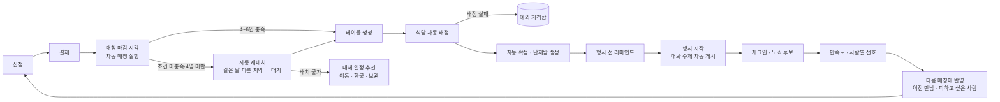

# 우연한 식탁 (siktak)

처음 보는 4~6명을 성향이 맞는 한 테이블로 연결하는 소셜다이닝 서비스 '우연한 식탁'의 운영 자동화 MVP.

> **정상 흐름은 자동, 운영자는 예외만.**
> 신청 → 결제 → 자동 매칭 → 자동 재배치 → 식당 배정 → 자동 확정·단체방 → 리마인드 → 체크인 → 피드백 → 다음 매칭까지 운영자 개입 없이 흐르고,
> 자동으로 풀리지 않은 건만 운영자 예외 처리함에 올라온다.

> 📄 **심사·제출용 한 장 요약: [docs/submission.md](docs/submission.md)**

## 바로 써보기

| 대상 | URL |
|---|---|
| 참가자 앱 (모바일 우선) | https://siktak-rho.vercel.app/app |
| 운영자 웹 | https://siktak-rho.vercel.app/admin |
| 시연 가이드 (12단계 안내) | https://siktak-rho.vercel.app/guide |
| API 문서 (Swagger) | https://siktak.onrender.com/swagger-ui.html |

> **첫 접속 안내**: 백엔드가 Render Free 인스턴스라 한동안 요청이 없으면 잠듭니다. **첫 요청은 최대 1분** 걸릴 수 있으니 로그인 화면이 늦게 반응해도 잠시 기다려 주세요. 시연 직전에는 `https://siktak.onrender.com/api/v1/health` 를 먼저 열어 깨워 두세요.

### 테스트 계정

| 구분 | ID | 비밀번호 | 용도 |
|---|---|---|---|
| 운영자 | `admin` | `siktak-admin!` | 운영자 웹, 데모 도구(`/admin/demo`) |
| 시연 참가자 | `demo01` | `siktak1234` | 프로필 입력 완료 · 신청 전 상태. 직접 신청·결제(모의)·체크인·피드백 |
| 일반 참가자 | `user01` ~ `user29` | `siktak1234` | 시드 참가자. 역할은 [docs/demo-scenario.md](docs/demo-scenario.md) 3장 (예: `user14` 일정 이동, `user23` 환불) |

테스트 전용 계정이며 결제는 모의(Mock)입니다. 실서비스 전환 시 전부 삭제합니다.
시연 순서는 [docs/demo-guide.md](docs/demo-guide.md)를 따라가면 됩니다.

## 자동화 흐름



- 필수 조건(4~6명, 날짜·지역 일치, 나이 차 8살 이내, 차단·신고·비선호 관계 없음)은 어떤 경우에도 완화하지 않고, 선호 조건은 점수로 합산한다. 명세: [docs/domain/matching.md](docs/domain/matching.md)
- 매칭·테이블·단체방·결제·알림은 두 번 실행돼도 결과가 같다(멱등).
- 자동 처리가 실패하면 로그로 끝내지 않고 `ExceptionCase`로 저장해 운영자 예외 처리함에 노출한다.

## 기술 스택·아키텍처

| 영역 | 스택 | 배포 |
|---|---|---|
| Backend | Java 21, Spring Boot 4, Spring Data JPA, Flyway, Spring Security(JWT), ShedLock, springdoc-openapi | Render (Docker) |
| Frontend | React, TypeScript, Vite, React Router, TanStack Query, axios, Tailwind CSS | Vercel |
| DB | PostgreSQL | Neon |

```
GitHub main push
   ├─ GitHub Actions ── backend 테스트 + frontend lint·build (배포 안 함)
   ├─ Vercel ────────── frontend/  → https://siktak-rho.vercel.app
   └─ Render ────────── backend/   → https://siktak.onrender.com
                              └─ Neon PostgreSQL (Singapore, production 브랜치)
```

백엔드는 도메인 단위 패키지(`com.siktak.{user, profile, slot, application, payment, matching, venue, chat, notification, content, feedback, safety, admin, ...}`)이고, 각 패키지는 `api` / `application` / `domain` / `infra`로 나뉜다. 매칭 엔진은 DB·시간·외부 의존이 없는 순수 함수다.

### 외부 연동은 포트/어댑터 + 설정값 전환

모든 외부 연동은 인터페이스 뒤에 두고 Mock 구현을 항상 함께 둔다. 데모 직전 불안정하면 설정값만 바꿔 Mock으로 돌린다.

| 포트 | 구현 | 전환 설정 |
|---|---|---|
| `PaymentGateway` | Mock (현재 사용) / Toss | `siktak.payment.provider=mock\|toss` (환경변수 `SIKTAK_PAYMENT_PROVIDER`) |
| `NotificationSender` | 앱 내 알림 (현재 사용) / 이후 푸시·알림톡 | `siktak.notification.channel=in-app` |
| `ContentGenerator` | 템플릿 (현재 사용) / 선택: LLM | — |
| 매칭 엔진 | `v2` 엔진 / `simple` 순차 매칭(비상용) | `SIKTAK_MATCHING_ENGINE=v2\|simple` |

연동 상태와 전환 방법: [docs/integrations.md](docs/integrations.md)

### 시연을 위한 장치

- **데모 시계**: 서버는 `Clock` 빈으로만 시각을 읽는다. `/admin/demo`에서 시계를 앞당기면(J1~J6) 실제 스케줄러와 같은 코드가 도래한 작업을 즉시 실행한다.
- **시드 초기화**: 같은 화면에서 한 번에 `demo-v1` 시드(참가자 30명·회차 5개·식당 4곳)로 되돌린다.
- 데모 도구는 `siktak.demo.enabled`(환경변수 `SIKTAK_DEMO_ENABLED`)가 true일 때만 열리며, 실서비스 전환 시 끈다.

## 폴더 구조

```
siktak/
├── backend/    # Spring Boot
├── frontend/   # Vite + React (/app 참가자, /admin 운영자)
├── docs/       # PRD, 도메인 명세, ERD, 결정 로그, 시연 문서
└── CLAUDE.md   # 개발 규칙
```

## 로컬 실행

사전 준비: JDK 21, Node.js 20 이상.

1. 루트의 `.env.example`을 복사해 `.env`를 만들고 키를 채운다 (`DB_URL`, `DB_USERNAME`, `DB_PASSWORD`, `JWT_SECRET`, `CORS_ALLOWED_ORIGINS` 등). 값은 커밋하지 않는다. DB는 PostgreSQL(Neon 개발 브랜치 권장)이며 Flyway가 기동 시 스키마를 만들고, 빈 DB면 데모 시드를 자동 투입한다.
2. 백엔드

```bash
cd backend
./gradlew bootRun          # 기본 프로필 local, http://localhost:8080
./gradlew test             # DB 없는 테스트. TEST_DB_* 를 설정하면 @Tag("db") 통합 테스트도 실행
```

   - 헬스체크: `GET /api/v1/health` (DB 확인: `/api/v1/health/db`)
   - API 문서: http://localhost:8080/swagger-ui.html

3. 프론트엔드

```bash
cd frontend
npm install
# frontend/.env.local 에 VITE_API_BASE_URL=http://localhost:8080
npm run dev                # http://localhost:5173
```

## 문서 지도

| 문서 | 내용 |
|---|---|
| [docs/prd.md](docs/prd.md) | PRD v0.2 원문 (모든 판단의 기준) |
| [docs/prd-analysis.md](docs/prd-analysis.md) | PRD·심사 기준 분석 |
| [docs/domain/states.md](docs/domain/states.md) | 상태 전이 명세 |
| [docs/domain/matching.md](docs/domain/matching.md) | 매칭 알고리즘 명세 |
| [docs/erd.md](docs/erd.md) | 데이터 모델 |
| [docs/decisions.md](docs/decisions.md) | 결정 로그 |
| [docs/demo-scenario.md](docs/demo-scenario.md) | 시연 시나리오·시드 데이터 (12단계) |
| [docs/demo-guide.md](docs/demo-guide.md) | 시연 진행표 (버튼 → 화면 → PRD ID) |
| [docs/integrations.md](docs/integrations.md) | 외부 연동·환경변수 |
| [docs/progress.md](docs/progress.md) | 진행 기록 |
