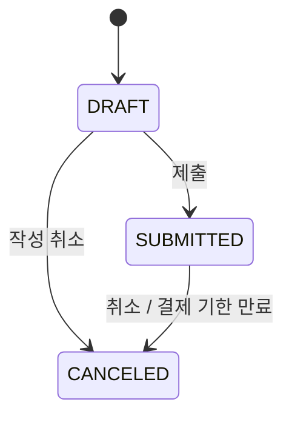
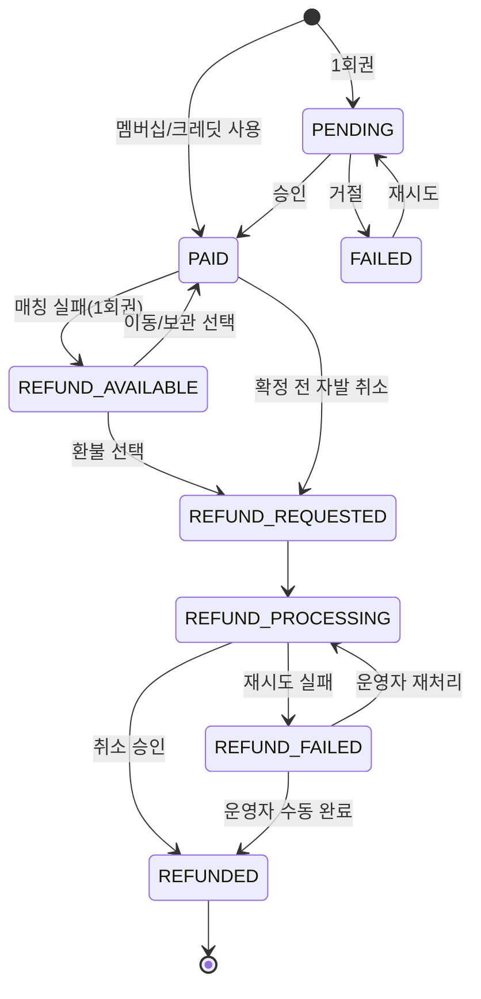
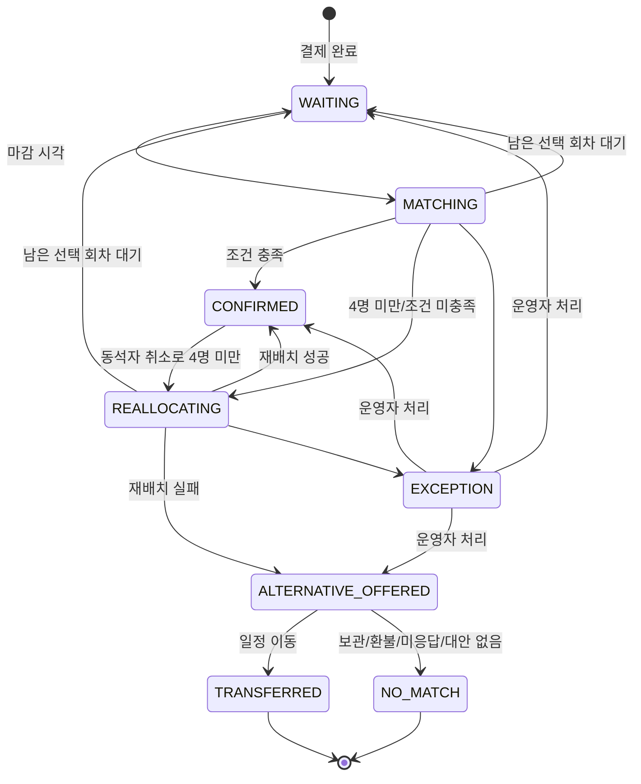
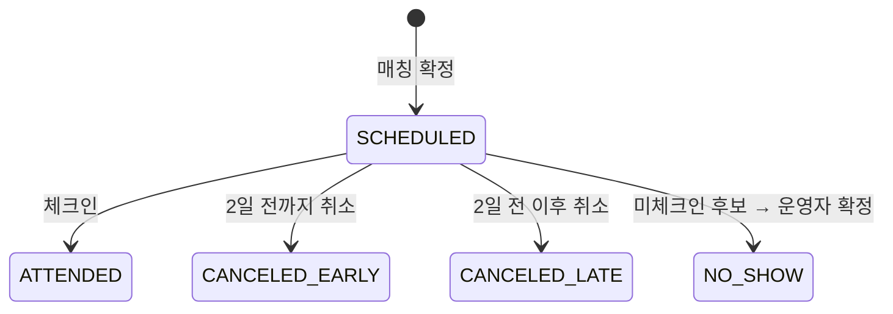

# 상태 전이 명세 (states.md)

> 위치: `docs/domain/states.md`
> 기준: PRD v0.2 12장(상태값), 7장(매칭 로직), 15장(예외 처리), 6.2·6.3(결제·상태)
> 작성: 2026-10-17 [기획]
> 표기: **[PRD]** PRD에 명시 · **[결정]** PRD 공백을 기획에서 정한 내용 (근거는 10장, `docs/decisions.md`에도 기록)

---

## 0. 기본 원칙

1. 상태는 **4개 축으로 분리**한다: 신청 · 결제 · 매칭 · 참석. 하나로 합치지 않는다. [PRD]
2. 상태값은 PRD 12장 enum만 쓴다. 새 값을 추가하지 않는다. [PRD]
3. 상태 변경은 도메인 서비스의 **명시된 전이 메서드**로만 한다. 표에 없는 전이는 예외를 던진다.
4. 모든 전이는 `StatusHistory`(audit log)에 기록한다: 대상, 축, 이전 값, 새 값, 주체, 트리거, 사유, 시각.
5. 같은 전이 요청이 두 번 와도 결과가 같아야 한다 (이미 목표 상태면 no-op, **이력은 남기지 않는다** — 재실행 노이즈·DB 쓰기 방지. 2026-10-17 변경).
6. 정책 수치(결제 기한, 체크인 시간 등)는 하드코딩하지 않고 **설정값**으로 둔다.

### 변경 주체 (actor)

| 코드 | 의미 |
|---|---|
| `PARTICIPANT` | 참가자 앱에서의 사용자 행동 |
| `SCHEDULER` | 시각 기반 자동 실행 (매칭 마감, 리마인드, 행사 종료 등). 운영자·데모 도구가 같은 작업을 수동으로 앞당겨 실행해도 주체는 `SCHEDULER`, 실행한 사람은 `actor_id`·`reason`에 남긴다 |
| `SYSTEM` | 다른 상태 변경에 연쇄되는 자동 처리 |
| `PAYMENT_GATEWAY` | 결제사 응답·웹훅 |
| `OPERATOR` | 운영자 어드민에서의 수동 처리 (예외 처리에 한정) |

---

## 1. 이용권과 결제 방식 [결정]

PRD APP-04(P0)는 "1회권 또는 구독 이용권을 선택할 수 있다"까지만 요구한다. MVP는 아래처럼 단순화한다.

| 이용권 | 가격 | 결제 시점 | 신청 시 처리 |
|---|---|---|---|
| 1회권 | 9,900원 | 신청 제출 후 결제 | 신청마다 결제 1건 |
| 1개월 멤버십 | 35,000원 | 신청과 별도로 먼저 구매 | 유효기간 내 신청은 추가 결제 없음 |
| 3개월 멤버십 | 75,000원 | 〃 | 〃 |
| 6개월 멤버십 | 120,000원 | 〃 | 〃 |

- 멤버십은 **1·3·6개월 기간권, 한 번 결제, 자동 갱신 없음**.
- 멤버십 기간 내 **참여 횟수 제한 없음**. 단, 같은 회차·같은 날 중복 신청 불가.
- **1회권 크레딧**: 매칭 실패 후 "이용권 보관"을 고르면, 그 결제는 다음 신청 1회에 쓸 수 있는 크레딧이 된다.
- MVP 범위 밖: 정기결제(자동 갱신), 멤버십 중도 해지·환불, 기간 내 횟수 제한, 남은 횟수·유효기간 관리 화면(RET-03, P1).

**데이터**: 보유 이용권을 `UserPass`(유형, 시작일, 만료일, 출처 결제)로 관리한다. 1회권 크레딧도 `UserPass`(유형 `SINGLE_CREDIT`)로 저장한다.

---

## 2. 신청 상태 `application_status`

| 값 | 의미 |
|---|---|
| `DRAFT` | 작성 중 |
| `SUBMITTED` | 신청 완료 |
| `CANCELED` | 신청 취소 |

### 전이표

| # | 이전 | 다음 | 주체 | 트리거 | 조건 | 연쇄 처리 |
|---|---|---|---|---|---|---|
| A1 | (없음) | `DRAFT` | PARTICIPANT | 신청 시작 | 로그인 | — |
| A2 | `DRAFT` | `SUBMITTED` | PARTICIPANT | 신청 제출 | 필수 항목 완료, 개인정보·정책 동의 (ACC-05, APP-03) | 결제 P1 또는 P1a |
| A3 | `DRAFT` | `CANCELED` | PARTICIPANT | 작성 취소 | — | — |
| A4 | `SUBMITTED` | `CANCELED` | PARTICIPANT | 신청 취소 | 매칭 확정 전, 행사 2일 전까지 | 결제 상태에 따라 8장 규칙 적용 |
| A5 | `SUBMITTED` | `CANCELED` | SYSTEM | 결제 기한 만료 | 결제 `PENDING` 상태로 기한 경과 | — |

> 매칭 확정 후 취소는 신청 상태가 아니라 **참석 상태**로 관리한다. 신청은 `SUBMITTED`로 유지한다. [결정]

---

## 3. 결제 상태 `payment_status`

| 값 | 의미 |
|---|---|
| `PENDING` | 결제 대기 |
| `PAID` | 결제 완료 |
| `FAILED` | 결제 실패 |
| `REFUND_AVAILABLE` | 매칭 불가로 환불 선택 가능 |
| `REFUND_REQUESTED` | 환불 요청 |
| `REFUND_PROCESSING` | 자동 환불 처리 중 |
| `REFUNDED` | 환불 완료 |
| `REFUND_FAILED` | 자동 환불 실패, 운영자 확인 필요 |

> 신청의 결제 상태는 "이 신청의 참가 비용이 해결되었는가"를 뜻한다. 1회권은 실제 결제, 멤버십·크레딧은 이용권 사용으로 `PAID`가 된다.

### 전이표

| # | 이전 | 다음 | 주체 | 트리거 | 조건 | 연쇄 처리 |
|---|---|---|---|---|---|---|
| P1 | (없음) | `PENDING` | SYSTEM | 신청 제출(A2) | 1회권 선택 | 결제 기한 안내 알림 |
| P1a | (없음) | `PAID` | SYSTEM | 신청 제출(A2) | 유효한 멤버십 또는 1회권 크레딧 보유 | 크레딧이면 1회 소진, 매칭 M1 |
| P2 | `PENDING` | `PAID` | PAYMENT_GATEWAY | 결제 승인 | 멱등 키·금액 일치 | 매칭 M1, 결제 완료 알림 |
| P3 | `PENDING` | `FAILED` | PAYMENT_GATEWAY | 결제 거절·오류 | — | 실패 안내 |
| P4 | `FAILED` | `PENDING` | PARTICIPANT | 재결제 시도 | 결제 기한 이내 | — |
| P5 | `PAID` | `REFUND_AVAILABLE` | SYSTEM | 매칭 실패(M6) | 1회권 결제 건만 | 대체 일정·보관·환불 선택지 제공 |
| P6 | `REFUND_AVAILABLE` | `REFUND_REQUESTED` | PARTICIPANT | 환불 선택 (STA-05) | — | 즉시 P8 |
| P7 | `REFUND_AVAILABLE` | `PAID` | PARTICIPANT | 일정 이동 또는 이용권 보관 선택 | — | M7 또는 M8 |
| P7a | `PAID` | `REFUND_REQUESTED` | PARTICIPANT | 매칭 확정 전 자발적 취소 (A4) | 1회권 결제 건, 행사 2일 전까지 | 즉시 P8 |
| P8 | `REFUND_REQUESTED` | `REFUND_PROCESSING` | SYSTEM | 환불 처리 시작 | 환불 멱등 키 발급 | PG 취소 API 호출 |
| P9 | `REFUND_PROCESSING` | `REFUNDED` | PAYMENT_GATEWAY | 취소 승인 | — | 환불 완료 알림 |
| P10 | `REFUND_PROCESSING` | `REFUND_FAILED` | SYSTEM | 자동 재시도 N회 실패 | — | `ExceptionCase(REFUND_FAILED)` 생성 |
| P11 | `REFUND_FAILED` | `REFUND_PROCESSING` | OPERATOR | 재처리 | — | PG 취소 재호출 |
| P12 | `REFUND_FAILED` | `REFUNDED` | OPERATOR | 수동 환불 완료 처리 | 사유 입력 필수 | 환불 완료 알림 |

**멤버십·크레딧으로 `PAID`된 신청**: 환불 대상이 아니다. 매칭 실패·자발적 취소 시 크레딧이면 1회 복원, 멤버십이면 추가 처리 없음.

**금지 전이**
- 매칭 확정 이후 또는 행사 2일 전 이후의 `PAID` → `REFUND_REQUESTED` (PAY-02)
- `REFUNDED`에서 나가는 전이 (종료 상태)
- 일정 이동 시 새 결제 생성 (기존 결제 유지, 중복 승인 방지) [PRD 7.3]

---

## 4. 매칭 상태 `match_status`

| 값 | 의미 |
|---|---|
| `WAITING` | 매칭 대기 |
| `MATCHING` | 자동 매칭 실행 중 |
| `REALLOCATING` | 4명 미만 또는 조건 미충족으로 자동 재배치 중 |
| `CONFIRMED` | 조건 검증을 통과해 자동 확정 |
| `ALTERNATIVE_OFFERED` | 매칭 실패 후 대체 일정·이용권 보관·환불 선택 대기 |
| `TRANSFERRED` | 사용자가 선택한 다른 일정으로 이동 완료 |
| `NO_MATCH` | 매칭 종료 (보관·환불 선택 또는 대안 없음) |
| `EXCEPTION` | 자동 처리 실패, 운영자 확인 필요 |

> 결제 완료 전에는 매칭 상태가 없다 (`null`). 결제 미완료자는 매칭 후보가 아니다. [PRD 15장]

### 전이표

| # | 이전 | 다음 | 주체 | 트리거 | 조건 | 연쇄 처리 |
|---|---|---|---|---|---|---|
| M1 | (없음) | `WAITING` | SYSTEM | 결제 `PAID` (P1a, P2) | 신청 `SUBMITTED` | 매칭 예정일 안내 |
| M2 | `WAITING` | `MATCHING` | SCHEDULER | 회차 매칭 마감 시각 (MAT-01) | 신청 `SUBMITTED` + 결제 `PAID` | `MatchRun` 시작 기록 |
| M3 | `MATCHING` | `CONFIRMED` | SYSTEM | 최초 조합이 필수 조건 + 최소 점수 충족 (MAT-10) | 재검증 통과 (MAT-07) | 참석 T1, 식당 배정, 단체방 생성, 확정 알림 |
| M4 | `MATCHING` | `REALLOCATING` | SYSTEM | 최초 조합 4명 미만 또는 조건 미충족 (MAT-08) | — | 재배치 중 안내 |
| M4a | `MATCHING`·`REALLOCATING` | `WAITING` | SYSTEM | 이번 실행에서 미배치, 본인이 선택한 회차 중 매칭 시각이 아직 오지 않은 회차가 남음 | — | "다음 일정에서 다시 매칭" 안내 (matching.md 5-8) |
| M5 | `REALLOCATING` | `CONFIRMED` | SYSTEM | 재배치 성공 후 재검증 통과 | 신청한 날짜·지역 범위 이내 | M3와 동일 |
| M6 | `REALLOCATING` | `ALTERNATIVE_OFFERED` | SYSTEM | 재배치 1~4단계 모두 실패 (MAT-11) | — | 1회권이면 P5, 대체 일정 추천, 실패 사유 알림 |
| M7 | `ALTERNATIVE_OFFERED` | `TRANSFERRED` | PARTICIPANT | 추천 일정 선택 (STA-06) | 대상 회차 모집 중 | 새 회차 신청 생성 (결제 공유, `PAID`) → 새 신청 M1 |
| M8 | `ALTERNATIVE_OFFERED` | `NO_MATCH` | PARTICIPANT | 이용권 보관 또는 환불 선택 | — | 보관: 1회권은 크레딧 발급 / 환불: P6 |
| M8a | `ALTERNATIVE_OFFERED` | `NO_MATCH` | SCHEDULER | 원래 행사일까지 미응답 | — | 이용권 보관으로 처리 (1회권은 크레딧 발급) |
| M9 | `ALTERNATIVE_OFFERED` | `NO_MATCH` | SYSTEM | 추천 가능한 대체 일정 없음 | — | 보관·환불 선택지만 제공 |
| M10 | `CONFIRMED` | `REALLOCATING` | SYSTEM | 동석자 취소로 4명 미만 (15장) | 대기자 충원 불가 | 기존 단체방 정리, 재배치 시작 |
| M11 | `MATCHING`·`REALLOCATING` | `EXCEPTION` | SYSTEM | 데이터 누락, 해결 불가 조건 충돌 (MAT-13) | — | `ExceptionCase` 생성 |
| M12 | `EXCEPTION` | `WAITING`·`CONFIRMED`·`ALTERNATIVE_OFFERED` | OPERATOR | 예외 처리 완료 | 사유 필수, 필수 조건 재검증 통과 | 처리 결과 알림 |

**규칙**
- 한 참가자는 동시에 두 테이블에 배치되지 않는다. [PRD 7.4]
- 재배치가 끝난 뒤에만 확정한다. [PRD 7.4]
- 매칭 실행이 중복되어도 이미 `CONFIRMED`인 참가자는 다시 다루지 않는다. [PRD 7.3]
- 일정 이동은 **기존 신청을 `TRANSFERRED`(종료)로 두고 새 회차 신청을 만든다.** 새 신청은 기존 결제를 참조하며 새 결제를 만들지 않는다. [결정]
- 미응답 시 자동 처리(M8a)는 환불처럼 되돌릴 수 없는 결정이 아니라 **보관**으로만 한다. 참가자는 크레딧으로 다음 신청을 하거나 운영자에게 환불을 요청할 수 있다. [결정]

---

## 5. 참석 상태 `attendance_status`

매칭 `CONFIRMED` 시점에 생성된다.

| 값 | 의미 |
|---|---|
| `SCHEDULED` | 참석 예정 |
| `ATTENDED` | 참석 완료 |
| `CANCELED_EARLY` | 사전 취소 |
| `CANCELED_LATE` | 당일 또는 제한 시점 이후 취소 |
| `NO_SHOW` | 노쇼 |

### 전이표

| # | 이전 | 다음 | 주체 | 트리거 | 조건 | 연쇄 처리 |
|---|---|---|---|---|---|---|
| T1 | (없음) | `SCHEDULED` | SYSTEM | 매칭 확정 (M3, M5) | — | 리마인드 예약 |
| T2 | `SCHEDULED` | `ATTENDED` | PARTICIPANT | 앱 체크인 (FDB-01) | 체크인 허용 시간 이내 | 피드백 요청 예약 |
| T3 | `SCHEDULED` | `CANCELED_EARLY` | PARTICIPANT | 참석 취소 | 행사 2일 전까지 | 1회권은 자동 환불(P7a와 동일 처리), 크레딧은 복원 / 테이블 인원 재확인 → 4명 미만이면 대기자 충원 또는 M10 |
| T4 | `SCHEDULED` | `CANCELED_LATE` | PARTICIPANT | 참석 취소 | 행사 2일 전 이후 | 환불 없음, 이용 제한 검토 대상, 테이블 인원 재확인 |
| T5 | `SCHEDULED` | `NO_SHOW` | OPERATOR | 노쇼 후보 확정 | 행사 종료까지 미체크인 → 시스템이 후보 표시 (FDB-01) | 이용 제한 검토 대상 |

> 노쇼는 시스템이 **후보만 표시**하고 운영자가 확정한다. [PRD FDB-01]

---

## 6. 상태 간 불변 조건

| 조건 | 규칙 |
|---|---|
| 매칭 대상 | 매칭 상태가 있으면 신청 `SUBMITTED` + 결제 `PAID` (또는 이후 환불 단계) |
| 확정 | 매칭 `CONFIRMED`이면 결제는 반드시 `PAID` |
| 환불 선택 | 결제 `REFUND_AVAILABLE`이면 매칭은 반드시 `ALTERNATIVE_OFFERED` |
| 참석 | 참석 상태는 매칭 `CONFIRMED` 이력이 있을 때만 존재 |
| 신청 취소 | 신청 `CANCELED`이면 매칭 상태는 `null`이거나 종료 상태 |
| 중복 배치 | 한 사용자는 같은 회차에 `CONFIRMED` 테이블 최대 1개 |

---

## 7. 시각 기반 자동 실행 (SCHEDULER)

| 시점 | 실행 내용 | 관련 전이 |
|---|---|---|
| 결제 기한 만료 | 미결제 신청 취소 | A5 |
| 회차 매칭 마감 시각 | 자동 매칭 실행 | M2 → M3/M4 → M5/M6 |
| 행사 1일 전 | 리마인드 발송 | (알림) |
| 행사 시작 시각 | 대화 콘텐츠 게시 | (알림) |
| 행사 종료 시각 | 미체크인 노쇼 후보 표시, 피드백 요청 | T5 준비 |
| 원래 행사일 경과 | 대체 일정 미응답자 보관 처리 | M8a |
| 피드백 미응답 | 1회 리마인드 (다음 신청은 막지 않음) | (알림) |

모든 스케줄 작업은 `Clock` 주입 기반이며 데모용 시간 제어로 앞당길 수 있다.

---

## 8. 취소·환불 정리

| 시점 | 참가자 행동 | 1회권 결제 | 멤버십 | 1회권 크레딧 |
|---|---|---|---|---|
| 결제 전 | 신청 취소 | 신청 `CANCELED` | — | — |
| 확정 전 · 2일 전까지 | 신청 취소 | 자동 환불 | 처리 없음 | 크레딧 복원 |
| 매칭 실패 | 환불 선택 | 자동 환불 | (선택지 없음) | 크레딧 복원 |
| 매칭 실패 | 보관 선택 / 미응답 | 크레딧 발급 | 처리 없음 | 크레딧 복원 |
| 매칭 실패 | 일정 이동 | 결제 유지, 새 신청 | 새 신청 | 새 신청 |
| 확정 후 · 2일 전까지 | 참석 취소 | 자동 환불 | 처리 없음 | 크레딧 복원 |
| 확정 후 · 2일 전 이후 | 참석 취소 | 환불 없음 | 처리 없음 | 복원 없음 |

---

## 9. 정책 설정값 (기본값)

| 키 | 기본값 | 의미 |
|---|---|---|
| `policy.payment-deadline-hours` | 24 | 신청 후 결제 기한 (매칭 마감이 더 빠르면 마감 시각) |
| `policy.refund-cutoff-days` | 2 | 행사 며칠 전부터 환불 불가 |
| `policy.checkin-open-minutes` | 30 | 행사 시작 몇 분 전부터 체크인 가능 |
| `policy.refund-retry-max` | 3 | 자동 환불 재시도 횟수 |
| `policy.notification-retry-max` | 3 | 알림 발송 재시도 횟수 |

---

## 10. 결정 사항

| # | 항목 | 결정 | 근거 |
|---|---|---|---|
| D1 | 이용권 구조 | 1회권 + 멤버십(1·3·6개월 기간권, 한 번 결제, 자동 갱신·횟수 제한 없음) | APP-04는 선택만 요구, 정기결제는 MVP 범위 밖 |
| D2 | 이용권 보관 | 새 상태 없이 매칭 `NO_MATCH` + 1회권 크레딧 발급 (`UserPass`) | PRD enum 유지 원칙 |
| D3 | 일정 이동 | 기존 신청 `TRANSFERRED` 종료 + 새 신청 생성, 결제 공유 | 한 신청에 `TRANSFERRED`·`WAITING` 동시 불가, 중복 결제 방지 |
| D4 | 확정 전·2일 전까지 자발 취소 | 1회권 자동 환불 | PRD는 2일 전 이후 환불 불가만 명시 |
| D5 | 확정 후·2일 전까지 취소 | 1회권 자동 환불 (`CANCELED_EARLY`) | D4와 같은 기준 |
| D6 | 대체 일정 미응답 | 원래 행사일 경과 시 보관 처리 (환불처럼 되돌릴 수 없는 결정은 자동으로 하지 않음) | PRD 7.3 "참가자가 선택" 원칙을 최대한 유지 |
| D7 | 정책 수치 | 9장 설정값으로 관리 | 회사 정책 확정 시 값만 변경 |
| D8 | 미배치 + 남은 선택 회차 있음 | `WAITING` 복귀 (M4a) | PRD 7.4 재배치 3·4단계(다른 날짜)를 회차별 매칭 시각과 맞추기 위함 |

> D4~D6는 회사 정책 확인 시 변경될 수 있다. 변경 시 이 표와 `docs/decisions.md`를 함께 수정한다.
