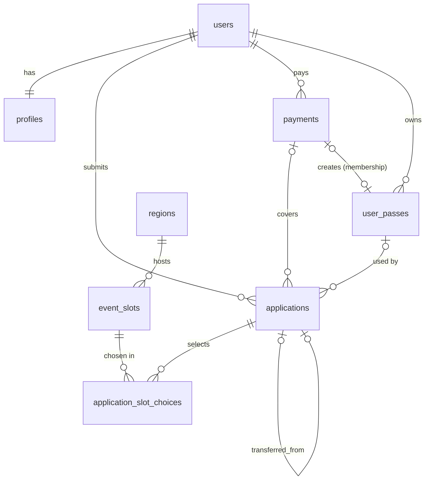
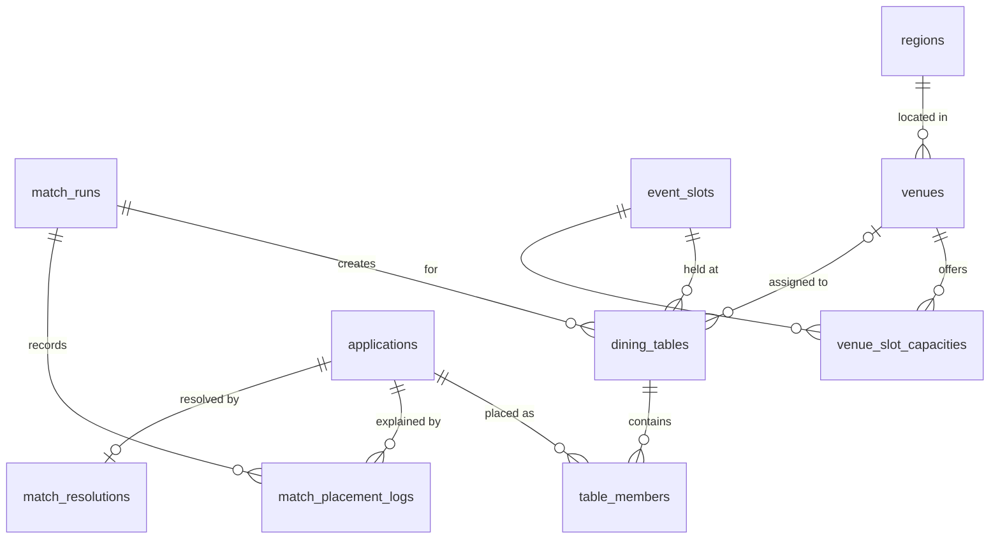
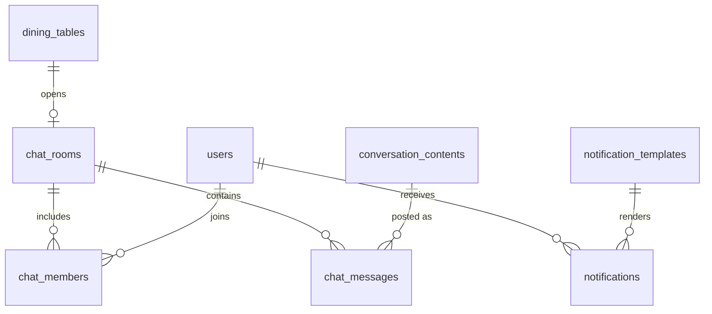
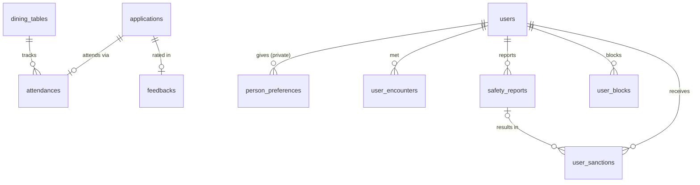
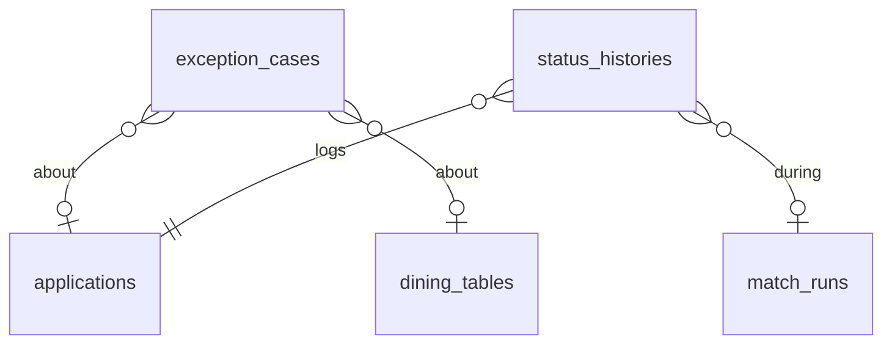

# 데이터 모델 (erd.md)

> 위치: `docs/erd.md`
> 기준: PRD v0.2 13장(주요 데이터 항목), `docs/domain/states.md`
> 작성: 2026-10-17 [기획]
> DB: PostgreSQL (Neon) · 마이그레이션: Flyway

---

## 0. 공통 규칙

- PK: `id BIGINT GENERATED ALWAYS AS IDENTITY`
- 모든 테이블에 `created_at`, `updated_at` (`timestamptz`)
- 시각은 `timestamptz`, 금액은 원 단위 `BIGINT`
- enum은 `VARCHAR` + 애플리케이션 enum (DB enum 타입 사용 안 함 → 값 추가 시 마이그레이션 부담 감소)
- 복수 선택 항목(관심사, 성향 등)은 `JSONB` 배열 (`@JdbcTypeCode(SqlTypes.JSON)`)
- 동시 수정이 잦은 테이블(`applications`, `dining_tables`)은 `version` 컬럼으로 낙관적 락
- 외부 호출·자동 생성 작업에는 `*_key` 유니크 컬럼으로 멱등성 보장
- 상태 컬럼명은 PRD 그대로: `application_status`, `payment_status`, `match_status`, `attendance_status`

---

## 1. PRD 13장 대응표

| PRD 데이터 | 테이블 | 비고 |
|---|---|---|
| 사용자 User | `users` | |
| 프로필 Profile | `profiles` | |
| 회차 EventSlot | `event_slots`, `regions` | 지역을 별도 테이블로 분리 |
| 신청 Application | `applications`, `application_slot_choices` | 복수 날짜·지역 선택을 분리 |
| 매칭 실행 MatchRun | `match_runs`, `match_placement_logs` | 배치 사유 로그 분리 (설명 가능성) |
| 테이블 DiningTable | `dining_tables`, `table_members` | 식당 배정 정보 포함 |
| 식당 Venue | `venues`, `venue_slot_capacities` | |
| 단체방 ChatRoom | `chat_rooms`, `chat_members`, `chat_messages` | |
| 미매칭 해결 MatchResolution | `match_resolutions` | |
| 예외 ExceptionCase | `exception_cases` | |
| 참석 Attendance | `attendances` | |
| 피드백 Feedback | `feedbacks`, `person_preferences` | 사람별 선호는 비공개 분리 |
| 안전 SafetyReport | `safety_reports`, `user_blocks`, `user_sanctions` | |
| 알림 Notification | `notifications`, `notification_templates` | |
| (추가) 결제 | `payments` | PG 거래 기록 |
| (추가) 이용권 | `user_passes` | states.md D1·D2 |
| (추가) 상태 이력 | `status_histories` | audit log |
| (추가) 만남 이력 | `user_encounters` | MAT-06 새로운 사람 우선 |
| (추가) 대화 콘텐츠 | `conversation_contents` | CON-01~03 |
| (추가) 설정 | `settings` | 정책 수치·매칭 가중치·데모 시계 |

---

## 2. 관계도

### 2-1. 사용자 · 신청 · 결제

### 2-2. 매칭 · 테이블 · 식당

### 2-3. 단체방 · 알림 · 콘텐츠

### 2-4. 참석 · 피드백 · 안전

### 2-5. 운영 · 기록

---

## 3. 테이블 상세

### 3-1. 사용자

**users**
| 컬럼 | 타입 | 설명 |
|---|---|---|
| id | bigint PK | |
| login_id | varchar unique | 테스트 계정 로그인 ID |
| password_hash | varchar | |
| auth_provider | varchar | `LOCAL` / (이후 `KAKAO`) |
| provider_user_id | varchar null | 소셜 로그인 식별자 |
| role | varchar | `PARTICIPANT` / `OPERATOR` |
| name | varchar | |
| phone | varchar | |
| account_status | varchar | `ACTIVE` / `RESTRICTED` / `BANNED` |

**profiles** (users 1:1)
| 컬럼 | 타입 | 설명 |
|---|---|---|
| user_id | bigint PK·FK | |
| birth_year | int | 나이 계산 기준 |
| gender | varchar | `MALE` / `FEMALE` |
| job | varchar | |
| mbti | varchar(4) | |
| interests | jsonb | 관심사 배열 |
| self_traits | jsonb | 본인 성향 배열 |
| preferred_traits | jsonb | 만나고 싶은 사람의 성향 배열 |
| conversation_style | varchar | 대화 성향 (조용한/활발한 등) |
| price_range | varchar | 희망 식사 가격대 |
| food_restrictions | text | 못 먹는 음식 |
| allergies | text | 알레르기 |
| privacy_agreed_at | timestamptz | 개인정보 동의 |
| policy_agreed_at | timestamptz | 운영 정책 동의 |

> 선택지 목록(관심사·성향 항목)은 `docs/domain/matching.md`에서 정의한다.

### 3-2. 회차

**regions**
| 컬럼 | 타입 | 설명 |
|---|---|---|
| id | bigint PK | |
| name | varchar unique | 예: 홍대/합정, 성수, 강남 |
| active | boolean | |

**event_slots**
| 컬럼 | 타입 | 설명 |
|---|---|---|
| id | bigint PK | |
| region_id | bigint FK | |
| starts_at | timestamptz | 행사 시작 시각 |
| ends_at | timestamptz | 행사 종료 시각 |
| capacity | int | 정원 (인원) |
| apply_deadline_at | timestamptz | 신청 마감 |
| match_run_at | timestamptz | 자동 매칭 실행 시각 |
| slot_status | varchar | `OPEN` / `CLOSED` / `MATCHED` / `DONE` / `CANCELED` |

> 회차 = 날짜·시간·지역 조합. 참가자는 여러 회차를 후보로 고른다.

### 3-3. 신청 · 결제 · 이용권

**applications**
| 컬럼 | 타입 | 설명 |
|---|---|---|
| id | bigint PK | |
| user_id | bigint FK | |
| pass_type | varchar | `SINGLE` / `MEMBERSHIP` / `CREDIT` |
| payment_id | bigint FK null | 1회권 결제 |
| user_pass_id | bigint FK null | 사용한 멤버십·크레딧 |
| application_status | varchar | states.md 2장 |
| payment_status | varchar null | states.md 3장 |
| match_status | varchar null | states.md 4장 |
| assigned_slot_id | bigint FK null | 확정된 회차 |
| transferred_from_id | bigint FK null | 일정 이동 시 원래 신청 (D3) |
| payment_due_at | timestamptz null | 결제 기한 |
| match_fail_reason | text null | 실패 사유 (참가자 노출용 문구) |
| submitted_at | timestamptz null | |
| version | bigint | 낙관적 락 |

**application_slot_choices**
| 컬럼 | 타입 | 설명 |
|---|---|---|
| id | bigint PK | |
| application_id | bigint FK | |
| event_slot_id | bigint FK | |
| priority | int | 선택 순서 (1이 최우선, matching.md MD7) |
| | | unique(application_id, event_slot_id) |

**payments** (PG 거래 기록)
| 컬럼 | 타입 | 설명 |
|---|---|---|
| id | bigint PK | |
| user_id | bigint FK | |
| purpose | varchar | `SINGLE_TICKET` / `MEMBERSHIP_1M` / `MEMBERSHIP_3M` / `MEMBERSHIP_6M` |
| amount | bigint | |
| provider | varchar | `MOCK` / `TOSS` |
| order_id | varchar unique | 멱등 키 (주문 번호) |
| provider_payment_key | varchar null | PG 결제 키 |
| tx_status | varchar | `READY` / `APPROVED` / `FAILED` / `CANCELED` / `CANCEL_FAILED` |
| approved_at | timestamptz null | |
| canceled_at | timestamptz null | |
| refund_key | varchar unique null | 환불 멱등 키 |
| retry_count | int | 환불 재시도 횟수 |
| last_error | text null | |

> `payments.tx_status`는 PG 거래 자체의 상태, `applications.payment_status`는 신청 관점의 도메인 상태. 둘을 혼동하지 않는다.

**user_passes**
| 컬럼 | 타입 | 설명 |
|---|---|---|
| id | bigint PK | |
| user_id | bigint FK | |
| pass_type | varchar | `MEMBERSHIP_1M` / `MEMBERSHIP_3M` / `MEMBERSHIP_6M` / `SINGLE_CREDIT` |
| starts_at | timestamptz | |
| expires_at | timestamptz null | 크레딧은 null 가능 |
| pass_status | varchar | `ACTIVE` / `USED` / `EXPIRED` |
| source_payment_id | bigint FK null | 멤버십 구매 결제 |
| source_application_id | bigint FK null | 크레딧이 생긴 원래 신청 |
| used_application_id | bigint FK null | 크레딧을 사용한 신청 |

### 3-4. 매칭

**match_runs**
| 컬럼 | 타입 | 설명 |
|---|---|---|
| id | bigint PK | |
| run_key | varchar unique | 멱등 키 (예: 대상 날짜 + 실행 차수) |
| target_date | date | 대상 행사 날짜 |
| algorithm_version | varchar | |
| params | jsonb | 실행 시점 가중치·최소 점수 스냅샷 |
| run_status | varchar | `RUNNING` / `COMPLETED` / `FAILED` |
| candidate_count | int | |
| summary | jsonb | 생성·분리·병합·재배치·확정·실패 건수 |
| started_at | timestamptz | |
| finished_at | timestamptz null | |
| failure_reason | text null | |

**dining_tables**
| 컬럼 | 타입 | 설명 |
|---|---|---|
| id | bigint PK | |
| event_slot_id | bigint FK | |
| match_run_id | bigint FK | |
| table_status | varchar | `CONFIRMED` / `DISSOLVED` / `COMPLETED` |
| member_count | int | |
| total_score | numeric | |
| score_detail | jsonb | 조건별 평가 결과 (PRD 7.2) |
| summary | jsonb | 연령 범위·성비·MBTI 구성·공통 관심사 등 (PRD 7.2) |
| venue_id | bigint FK null | 배정 식당 |
| reservation_name | varchar null | 예약명 |
| venue_assigned_at | timestamptz null | |
| confirmed_at | timestamptz null | |
| version | bigint | 낙관적 락 |

**table_members**
| 컬럼 | 타입 | 설명 |
|---|---|---|
| id | bigint PK | |
| dining_table_id | bigint FK | |
| application_id | bigint FK | |
| user_id | bigint FK | |
| active | boolean | 이탈 시 false |
| joined_at | timestamptz | |
| left_at | timestamptz null | |
| | | 부분 유니크: (application_id) where active |

**match_placement_logs** (설명 가능성)
| 컬럼 | 타입 | 설명 |
|---|---|---|
| id | bigint PK | |
| match_run_id | bigint FK | |
| application_id | bigint FK | |
| decision | varchar | `PLACED` / `REALLOCATED` / `CONFIRMED` / `FAILED` / `DEFERRED` / `EXCLUDED` |
| from_table_id | bigint null | |
| to_table_id | bigint null | |
| from_slot_id | bigint null | 재배치 출발 회차 |
| to_slot_id | bigint null | 재배치 도착 회차 |
| cause_code | varchar null | 처음 미배치 원인 (matching.md 11장 I8) |
| realloc_step | int null | PRD 7.4 재배치 단계 (1~4) |
| reason_code | varchar | 예: `UNDER_MIN_SIZE`, `AGE_GAP`, `BLOCKED_PAIR`, `LOW_SCORE` |
| reason_text | text | 사람이 읽을 수 있는 설명 |

**match_resolutions**
| 컬럼 | 타입 | 설명 |
|---|---|---|
| id | bigint PK | |
| application_id | bigint FK unique | |
| offered_slot_ids | jsonb | 추천 대체 회차 목록 |
| choice | varchar null | `TRANSFER` / `KEEP` / `REFUND` |
| chosen_slot_id | bigint null | |
| new_application_id | bigint null | 이동으로 생긴 새 신청 |
| resolution_status | varchar | `OFFERED` / `RESOLVED` / `AUTO_KEPT` |
| respond_by | timestamptz | 원래 행사일 (미응답 시 보관, D6) |
| responded_at | timestamptz null | |

**user_encounters** (MAT-06)
| 컬럼 | 타입 | 설명 |
|---|---|---|
| id | bigint PK | |
| user_low_id | bigint | 두 사용자 중 작은 ID |
| user_high_id | bigint | 큰 ID |
| dining_table_id | bigint FK | |
| met_at | timestamptz | |
| | | unique(user_low_id, user_high_id, dining_table_id) |

> 행사 종료 후 같은 테이블의 `ATTENDED` 참가자 쌍으로 생성한다.

### 3-5. 식당

**venues**
| 컬럼 | 타입 | 설명 |
|---|---|---|
| id | bigint PK | |
| region_id | bigint FK | |
| name | varchar | |
| address | varchar | |
| map_url | varchar | |
| price_range | varchar | |
| description | text | 큐레이션 문구 |
| active | boolean | |

**venue_slot_capacities**
| 컬럼 | 타입 | 설명 |
|---|---|---|
| id | bigint PK | |
| venue_id | bigint FK | |
| event_slot_id | bigint FK | |
| max_tables | int | 수용 가능한 테이블 수 |
| max_seats_per_table | int | 테이블당 최대 인원 |
| reserved_tables | int | 배정된 테이블 수 |
| | | unique(venue_id, event_slot_id) |

### 3-6. 단체방 · 알림 · 콘텐츠

**chat_rooms**
| 컬럼 | 타입 | 설명 |
|---|---|---|
| id | bigint PK | |
| dining_table_id | bigint FK unique | 테이블당 1개 (멱등) |
| room_status | varchar | `ACTIVE` / `CLOSED` |

**chat_members**
| 컬럼 | 타입 | 설명 |
|---|---|---|
| id | bigint PK | |
| chat_room_id | bigint FK | |
| user_id | bigint FK | |
| joined_at | timestamptz | |
| left_at | timestamptz null | |
| | | unique(chat_room_id, user_id) |

**chat_messages**
| 컬럼 | 타입 | 설명 |
|---|---|---|
| id | bigint PK | |
| chat_room_id | bigint FK | |
| sender_type | varchar | `USER` / `SYSTEM` |
| sender_id | bigint null | |
| message_type | varchar | `TEXT` / `NOTICE` / `CURATION` / `REMINDER` / `CONTENT` |
| body | text | |
| payload | jsonb null | 식당 카드·콘텐츠 등 구조화 데이터 |
| message_key | varchar unique null | 시스템 메시지 중복 방지 키 |

**notifications**
| 컬럼 | 타입 | 설명 |
|---|---|---|
| id | bigint PK | |
| user_id | bigint FK | |
| template_code | varchar | |
| channel | varchar | `IN_APP` / (이후 `PUSH`, `ALIMTALK`) |
| title | varchar | |
| body | text | |
| payload | jsonb null | 이동 링크 등 |
| scheduled_at | timestamptz | |
| send_status | varchar | `PENDING` / `SENT` / `FAILED` / `CANCELED` |
| attempts | int | |
| last_error | text null | |
| sent_at | timestamptz null | |
| read_at | timestamptz null | |
| dedup_key | varchar unique | 같은 알림 중복 발송 방지 |

**notification_templates**
| 컬럼 | 타입 | 설명 |
|---|---|---|
| code | varchar PK | 예: `MATCH_CONFIRMED`, `REMINDER_D1` |
| title_template | varchar | |
| body_template | text | 변수 치환 `{{venueName}}` 등 |
| active | boolean | |

**conversation_contents**
| 컬럼 | 타입 | 설명 |
|---|---|---|
| id | bigint PK | |
| content_type | varchar | `TOPIC` / `ICEBREAKER` |
| title | varchar | |
| body | text | |
| tags | jsonb | 연관 관심사·대화 성향 |
| active | boolean | |

### 3-7. 참석 · 피드백 · 안전

**attendances**
| 컬럼 | 타입 | 설명 |
|---|---|---|
| id | bigint PK | |
| application_id | bigint FK unique | |
| dining_table_id | bigint FK | |
| user_id | bigint FK | |
| attendance_status | varchar | states.md 5장 |
| no_show_candidate | boolean | 행사 종료 시 미체크인 표시 |
| checked_in_at | timestamptz null | |
| canceled_at | timestamptz null | |

**feedbacks**
| 컬럼 | 타입 | 설명 |
|---|---|---|
| id | bigint PK | |
| application_id | bigint FK unique | |
| dining_table_id | bigint FK | |
| user_id | bigint FK | |
| table_rating | int | 테이블 분위기 1~5 |
| conversation_rating | int | 대화 1~5 |
| venue_rating | int | 식당 1~5 |
| rejoin_intent | int | 재참여 의향 1~5 |
| recommend_score | int | 추천 의향 0~10 |
| comment | text null | |
| submitted_at | timestamptz | |

**person_preferences** (비공개)
| 컬럼 | 타입 | 설명 |
|---|---|---|
| id | bigint PK | |
| from_user_id | bigint FK | |
| to_user_id | bigint FK | |
| dining_table_id | bigint FK | |
| preference | varchar | `WANT_AGAIN` / `AVOID` |
| | | unique(from_user_id, to_user_id, dining_table_id) |

**user_blocks**
| 컬럼 | 타입 | 설명 |
|---|---|---|
| id | bigint PK | |
| blocker_id | bigint FK | |
| blocked_id | bigint FK | |
| source | varchar | `USER_BLOCK` / `REPORT` |
| | | unique(blocker_id, blocked_id) |

**safety_reports**
| 컬럼 | 타입 | 설명 |
|---|---|---|
| id | bigint PK | |
| reporter_id | bigint FK | |
| reported_id | bigint FK | |
| dining_table_id | bigint FK null | |
| reason_type | varchar | |
| description | text | |
| evidence_url | varchar null | |
| report_status | varchar | `RECEIVED` / `REVIEWING` / `RESOLVED` / `DISMISSED` |
| handled_by | bigint FK null | 운영자 |
| handled_at | timestamptz null | |

> 신고 접수 즉시 `user_blocks`(source=`REPORT`)를 생성해 향후 매칭에서 분리한다. (PRD 15장)

**user_sanctions**
| 컬럼 | 타입 | 설명 |
|---|---|---|
| id | bigint PK | |
| user_id | bigint FK | |
| sanction_type | varchar | `WARNING` / `RESTRICTION` / `PERMANENT_BAN` |
| reason | text | |
| report_id | bigint FK null | |
| starts_at | timestamptz | |
| ends_at | timestamptz null | |
| operator_id | bigint FK | |

### 3-8. 운영 · 기록

**exception_cases**
| 컬럼 | 타입 | 설명 |
|---|---|---|
| id | bigint PK | |
| case_type | varchar | `PAYMENT_ERROR` / `REFUND_FAILED` / `DATA_MISSING` / `MATCH_CONFLICT` / `VENUE_UNAVAILABLE` / `NOTIFICATION_FAILED` / `SAFETY_REPORT` / `NO_SHOW_CANDIDATE` (7.1, 행사 종료 시 미체크인 노쇼 후보) |
| case_status | varchar | `OPEN` / `IN_PROGRESS` / `RESOLVED` |
| application_id | bigint FK null | |
| dining_table_id | bigint FK null | |
| ref_type | varchar null | 기타 대상 (예: `PAYMENT`, `NOTIFICATION`) |
| ref_id | bigint null | |
| reason | text | |
| detail | jsonb null | |
| case_key | varchar unique | 같은 예외 중복 생성 방지 |
| resolved_by | bigint FK null | |
| resolution_note | text null | |
| resolved_at | timestamptz null | |

**status_histories** (states.md 8장)
| 컬럼 | 타입 | 설명 |
|---|---|---|
| id | bigint PK | |
| target_type | varchar | `APPLICATION` / `PAYMENT` / `ATTENDANCE` |
| target_id | bigint | |
| axis | varchar | `APPLICATION` / `PAYMENT` / `MATCH` / `ATTENDANCE` |
| from_status | varchar null | |
| to_status | varchar | |
| transition_code | varchar | 예: `M6` |
| actor_type | varchar | `PARTICIPANT` / `SCHEDULER` / `SYSTEM` / `PAYMENT_GATEWAY` / `OPERATOR` |
| actor_id | bigint null | |
| reason | text null | |
| match_run_id | bigint FK null | |
| created_at | timestamptz | |

**settings**
| 컬럼 | 타입 | 설명 |
|---|---|---|
| key | varchar PK | 예: `policy.refund-cutoff-days`, `matching.weights`, `matching.min-score`, `demo.clock-offset` |
| value | jsonb | |
| updated_by | bigint null | |

**shedlock** — ShedLock 라이브러리 기본 스키마 사용

---

## 4. 주요 제약 · 인덱스

| 대상 | 내용 | 목적 |
|---|---|---|
| `table_members` | 부분 유니크 `(application_id) WHERE active` | 한 신청이 동시에 두 테이블에 배치 금지 |
| `chat_rooms.dining_table_id` | unique | 단체방 중복 생성 방지 |
| `match_runs.run_key` | unique | 매칭 중복 실행 방지 |
| `payments.order_id`, `refund_key` | unique | 결제·환불 중복 방지 |
| `notifications.dedup_key` | unique | 알림 중복 발송 방지 |
| `chat_messages.message_key` | unique | 시스템 메시지 중복 게시 방지 |
| `exception_cases.case_key` | unique | 예외 중복 생성 방지 |
| `applications` | index `(match_status)`, `(user_id)` | 매칭 후보 조회 |
| `application_slot_choices` | index `(event_slot_id)` | 회차별 후보군 구성 |
| `event_slots` | index `(match_run_at)` | 스케줄러 조회 |
| `notifications` | index `(send_status, scheduled_at)` | 발송 워커 조회 |
| `status_histories` | index `(target_type, target_id)` | 이력 조회 |

---

## 5. 설계 메모

- **회차 = 날짜·시간·지역 조합.** 복수 선택은 `application_slot_choices`로 표현하고, 매칭은 같은 날짜의 회차들을 한 번에 실행한다 (상세는 `matching.md`).
- **매칭 결과는 3단으로 남긴다**: 실행 단위(`match_runs`) → 테이블 단위(`dining_tables.score_detail`, `summary`) → 참가자 단위(`match_placement_logs`). 참가자·운영자에게 보여줄 설명은 이 데이터로 만든다.
- **비공개 데이터 분리**: `person_preferences`, `user_blocks`, `safety_reports`는 참가자 API에서 본인이 작성한 것 외에는 조회되지 않는다.
- **식당 배정은 테이블에 포함**: MVP에서는 `dining_tables.venue_id`로 충분하다. 예약 변경 이력이 필요해지면 별도 테이블로 분리한다.
- **MVP에서 만들지 않는 것**: 정기결제 빌링 키, 멤버십 해지, 푸시 토큰(이후 `PUSH` 채널 추가 시 `user_devices` 테이블 추가).
